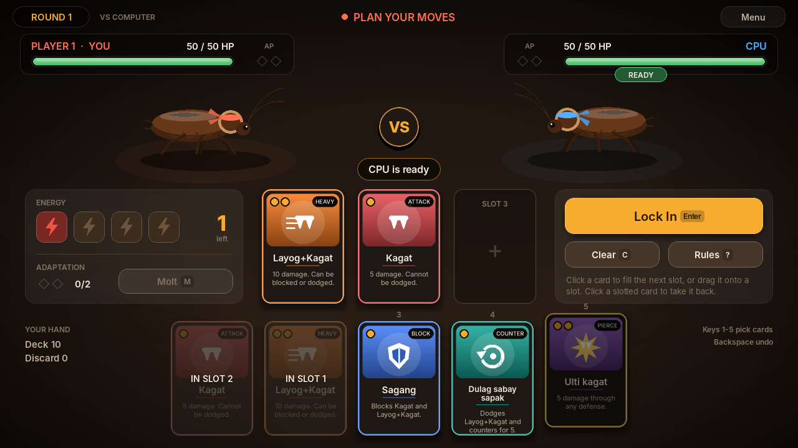
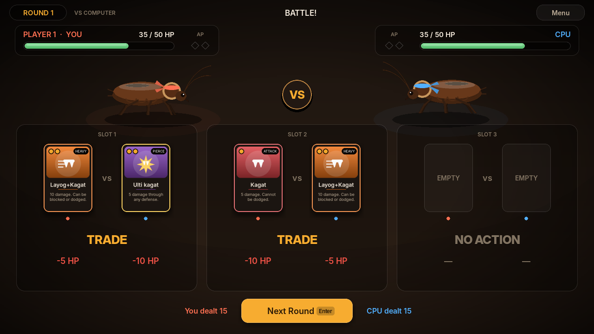

# IPIS Arena: full networked game

The complete *Cock Fight: Ipis Edition*, with the work split by language:

| Part | Language | Files |
| --- | --- | --- |
| Game rules | C | `../game_logic_demo/game.c` (the existing combat engine, unchanged) |
| Networking | C | `server.c` (match server), `client.c` (connection), `../socket_io.h` |
| Computer opponent | C | `cpu.c`, `cpu.h` |
| Graphics and input | Python | `gui/` (pygame) |

The Python GUI never opens a socket and never applies a rule. It starts the C
programs and exchanges text lines with `ipis_client` through a pipe:

```
 Python GUI  ──pipe──  ipis_client  ══TCP══  ipis_server  ══TCP══  ipis_client  ──pipe──  Python GUI
 (draws, reads          (C sockets)          (C sockets +           (other player)
  mouse/keyboard)                             game.c rules)
```




## Set up on Ubuntu

```sh
sudo apt install build-essential python3-pygame   # or: python3 -m pip install pygame
cd full_game
make            # builds ipis_server and ipis_client
```

The GUI also runs `make` by itself the first time if the programs are missing.

## Play

```sh
cd full_game/gui
python3 ipis_arena.py
```

- **Play vs Computer**: starts `ipis_server --cpu` on this computer. The C
  CPU never sees your hand or your plan; it uses its own hand and the cards you
  revealed in earlier rounds.
- **Host Online Game**: starts `ipis_server` on the chosen port (default 5001)
  and shows the addresses your opponent can join.
- **Join Online Game**: enter the host's IPv4 address and port.

To try online play on one computer, open two GUI windows: host in one, and
join `127.0.0.1` port `5001` in the other. Between two computers, both must be
on a network where the host's port is reachable (allow it through the firewall,
for example `sudo ufw allow 5001/tcp`).

The server can also run on its own, and `ipis_client` can be used from a
terminal to type protocol commands by hand:

```sh
./ipis_server 5001          # two players
./ipis_server 5001 --cpu    # one player against the CPU
./ipis_client 127.0.0.1 5001
```

## Controls

| Action | Mouse | Keyboard |
| --- | --- | --- |
| Put a card in the next free slot | Click the card | `1`–`5` |
| Put a card in a particular slot | Drag it onto the slot | – |
| Take a card back | Click it in its slot | `Backspace` (last card) |
| Clear all slots | **Clear** | `C` |
| Molt (needs 2 AP) | **Molt**, then click a card | `M`, then `1`–`5` |
| Lock in the plan, or pass with empty slots | **Lock In** / **Pass Round** | `Enter` |
| Skip the battle animation | Click | `Space` |
| Pause, rules, leave the match | **Menu** | `Esc` |

## Rules

| Card | Energy | Effect |
| --- | --- | --- |
| Kagat | 1 | 5 damage. Cannot be dodged. |
| Layog+Kagat | 2 | 10 damage. Can be blocked or dodged. |
| Sagang | 1 | Blocks Kagat and Layog+Kagat. |
| Dulag sabay sapak | 1 | Dodges Layog+Kagat and counters for 5. |
| Ulti kagat | 2 | 5 damage through any defense. |

These are the rules and demo decisions of `game_logic_demo` (see its
README): 50 HP, identical 15-card decks, 5-card hands, 4 energy and up to 3
slots per round, 1 AP per successful block or dodge (maximum 2), Molt for
2 AP, and a draw when both players reach 0 HP in the same round.

## Protocol

Every message is one line of text. The server checks everything; an invalid
command gets an `ERROR` reply and changes nothing.

| Client sends | Meaning |
| --- | --- |
| `PLAN a b c` | Lock in hand positions for slots 1–3 (`0` = empty slot). |
| `MOLT n` | Spend 2 AP to replace hand position `n`, before locking in. |
| `REMATCH` | After a match, ask to play again. |
| `QUIT` | Leave. Closing the client's input sends this automatically. |

| Server sends | Meaning |
| --- | --- |
| `WELCOME p HUMAN\|CPU` | You are player index `p` (0 or 1); the type of opponent. |
| `WAITING` | Waiting for the second player to connect. |
| `START` | A new match begins. |
| `STATE round hp1 hp2 ap1 ap2 deck discard n cards...` | Start of your planning. Includes only **your** hand. |
| `LOCKED` / `OPPONENT_LOCKED` | Your plan, or the other player's, is locked. The other player's cards are not sent. |
| `RESULT round outcome cards[6] damage[6] defended[6] hp_before[2] ap_before[2] hp[2] ap[2]` | Both plans revealed and resolved. Player 1's values come first. |
| `OPPONENT_REMATCH` | The other player wants a rematch. |
| `OPPONENT_LEFT` | The other player left; the session ends. |
| `FULL` | The match already has two players. |
| `ERROR text` | The last command was rejected. |

`outcome` uses `enum Outcome` from `game.h`: 0 ongoing, 1 Player 1 wins,
2 Player 2 wins, 3 draw. Card ids follow `enum Card`.

## Files

| File | Purpose |
| --- | --- |
| `server.c` | Accepts players, runs rounds with `game_resolve`, sends private hands and public results. |
| `client.c` | Connects to the server and relays lines between the socket and standard input/output. |
| `cpu.c`, `cpu.h` | Computer opponent; learns card interactions from the engine itself. |
| `Makefile` | `make` builds both programs; `make test` runs the network tests. |
| `test_network.py` | Starts the real server and clients and checks the protocol end to end. |
| `gui/ipis_arena.py` | Screens and game flow. Run this file. |
| `gui/ui.py` | Theme, card art, cockroach fighters, buttons, HP bars, text fields. |
| `gui/bridge.py` | Starts the C programs and passes lines to and from them. |
| `gui/cards.py` | Card names, costs and descriptions for drawing (display data only). |

## Tests

```sh
cd full_game
make test
```

The network tests check: invalid commands (duplicate positions, energy,
range, malformed and over-long lines); the two presentation rounds from
`game_logic_demo/PRESENTATION.md`, including Molt; that a player only learns
the opponent has locked in, never their cards; a full match, rematch, a third
player being refused, and a player leaving; a freed seat before the match;
five complete CPU matches with no rejected CPU plan; and bad arguments.

`ipis_client` uses `select()` on standard input, so it needs Linux or macOS.
